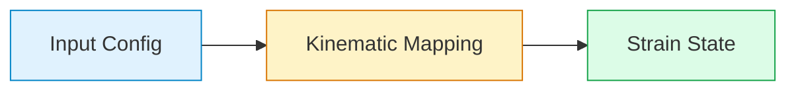

# Website Maintenance & Operations Guide

This guide covers daily maintenance, updating content, and managing the live status of **[vinayakvijay.github.io](https://vinayakvijay.github.io)**.

---

## 1. Taking the Website Offline & Restoring It

### Terminal Method (Recommended)

#### To Shut Down the Website (Offline):
Run these two commands:
```bash
# 1. Delete the live deployment branch (site immediately goes 404)
git push origin --delete gh-pages

# 2. Disable automated builds so future git pushes don't re-publish it
gh workflow disable deploy.yml
```
*Effect:* The live site is immediately taken offline. Your source code, commits, and config on `master` remain completely intact.

#### To Bring the Website Back Online:
Run these two commands:
```bash
# 1. Re-enable the automated deploy workflow
gh workflow enable deploy.yml

# 2. Trigger the build to republish the site
gh workflow run deploy.yml
```
*(Or push any commit to `master` after re-enabling—GitHub Actions will build and publish `gh-pages` within 2 minutes.)*

---

### GitHub Web UI Method

#### To Shut Down:
1. Open your repository: `https://github.com/vinayakvijay/vinayakvijay.github.io`
2. Go to **Settings** → **Pages** (in the left sidebar).
3. Next to *"Your site is live at..."*, click the **three dots (`...`)** and select **Unpublish site**.
4. Go to **Actions** tab → Select **Deploy site** on the left → Click `...` → **Disable workflow**.

#### To Bring Back Online:
1. Go to **Actions** tab → Select **Deploy site** → Click **Enable workflow**.
2. Click **Run workflow** (from branch `master`).
3. In **Settings** → **Pages**, confirm the source is set to **Deploy from a branch** → `gh-pages` / `/ (root)`.

---

## 2. Managing Content

### Adding a Publication
Add standard BibTeX entries directly to `_bibliography/papers.bib`:
```bibtex
@article{vinayak2026example,
  abbr={Comp. Mech.},
  bibtex_show={true},
  title={Your Paper Title Here},
  author={Vinayak and Kumar, Ajeet},
  journal={Computational Mechanics},
  year={2026},
  selected={true}
}
```
* `abbr`: Badge label shown on the left (e.g. `EJMS`, `arXiv`, `NeurIPS`).
* `selected={true}`: Displays the paper on both the front page and the publications page.
* `bibtex_show={true}`: Adds an expandable BibTeX button.

---

### Writing Blog Posts with Colorful Formatting
Create a new Markdown file inside `_posts/` with the naming scheme:  
`YYYY-MM-DD-title.md` (e.g., `_posts/2026-11-12-new-post.md`).

#### Colorful Callouts / Blockquotes
```markdown
> ##### TIP
> Green accent block for insights, best practices, and takeaways.
{: .block-tip }

> ##### WARNING
> Amber/yellow accent block for caveats, assumptions, and edge cases.
{: .block-warning }

> ##### DANGER
> Red accent block for critical warnings and numerical instability pitfalls.
{: .block-danger }
```

#### Math with Color Highlighting
```markdown
$$
\mathbf{r}'(s) = \mathbf{d}_3(s) + \color{#0ea5e9}{\mathbf{v}(s)}
$$
```

#### Mermaid Flowcharts
Add `mermaid: { enabled: true }` in the post's YAML frontmatter:
```markdown

```

---

### Adding Recent News
Add a `.md` file to `_news/` (e.g., `_news/2026-11-12-announcement.md`):
```markdown
---
layout: post
date: 2026-11-12
inline: true
related_posts: false
---

Paper accepted at Computational Mechanics! Check it out in the publications tab.
```

---

### Updating Bio & Profile Photo
* **Bio & Address:** Edit `_pages/about.md`.
* **Profile Photo:** Replace `assets/img/photo_vinayak.png` with any new photo.
* **Social Links:** Edit `_data/socials.yml`.
